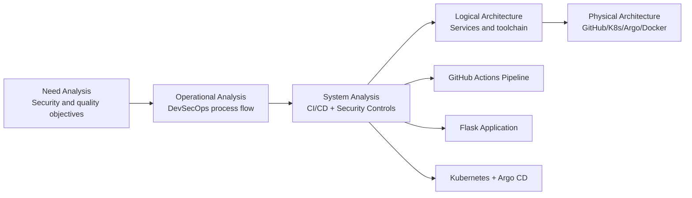
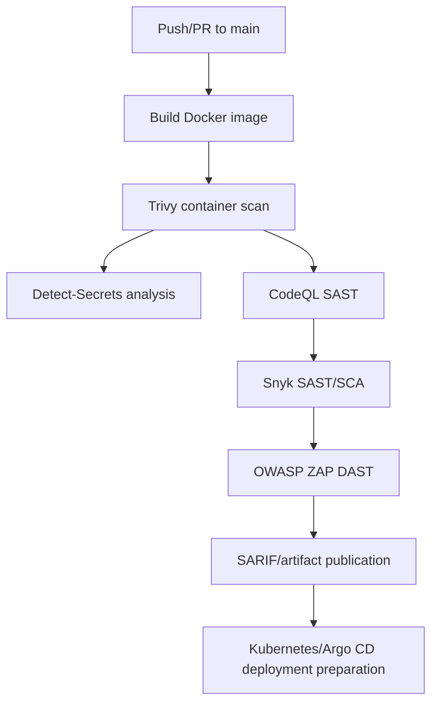
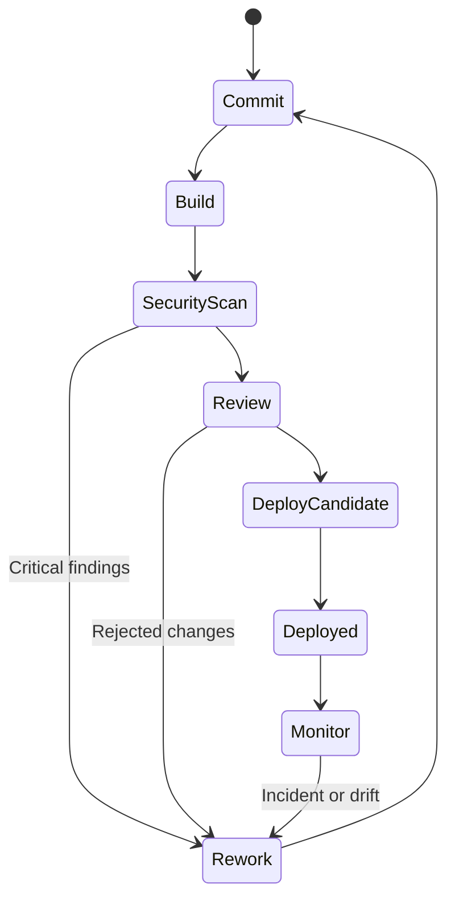

# DevSecOps-NYIT-VAN

Academic and practical repository designed to demonstrate a DevSecOps approach for software supply chain security, integrating automated security analysis in CI/CD, Kubernetes deployment, and GitOps operations with Argo CD.


## Table of Contents

- [Project Summary](#project-summary)
- [Technical Scope](#technical-scope)
- [Architecture (ISO/IEC 42010 + Arcadia)](#architecture-isoiec-42010--arcadia)
- [Flows and State Models (Mermaid)](#flows-and-state-models-mermaid)
- [Compliance and Reference Frameworks](#compliance-and-reference-frameworks)
- [Results and Evidence](#results-and-evidence)
- [ACM Poster](#acm-poster)
- [Repository Structure](#repository-structure)
- [Contributing](#contributing)
- [License](#license)

## Project Summary

Developed in the context of INCS-870-VA-2025, this project implements a continuous security pipeline for software supply chain assurance, including SAST/DAST/SCA, container scanning, secret detection, and deployment-oriented controls.

## Technical Scope

- Flask web application with security controls for critical routes.
- GitHub Actions pipeline for build, security analysis, and reporting.
- Kubernetes deployment support and declarative GitOps operation with Argo CD.
- Academic evidence in PDF artifacts, LaTeX paper, and conference visual material.

## Architecture (ISO/IEC 42010 + Arcadia)

Architectural documentation follows ISO/IEC 42010 and an Arcadia-oriented layered view model (Need, Operational, System, Logical, Physical).



## Flows and State Models (Mermaid)

### Primary CI/CD security flow



### Operational state machine



## Compliance and Reference Frameworks

### ISO/IEC 42010 (Architecture Description)

- Stakeholders, concerns, viewpoints, and views are represented through security and deployment perspectives.
- Traceability is established between security objectives and architectural decisions.

### Arcadia (Model-Based Architecture Method)

- Layered decomposition is used to separate mission needs, operations, system capabilities, logical composition, and physical deployment.

### ISO/IEC 330xx (Process Assessment)

- Serves as a process capability reference for continuous improvement in secure SDLC execution.
- Applicable to CI/CD security orchestration, vulnerability management, and response processes.

### ISO/IEC 42001 (AI Management System)

- Provides governance guidance for AI-assisted threat detection, oversight, and risk control in automation contexts.

### OWASP AI and OWASP Cybersecurity

- OWASP guidance is applied to application and pipeline controls (SAST, DAST, SCA, secrets management).
- OWASP AI perspectives are considered for emerging risks such as model misuse, prompt abuse, and AI-related data exposure.

## Results and Evidence

The following results were extracted from repository documentation and implementation artifacts, with an academic severity framing.

### Source corpus used for evidence extraction

- `Documentation/Automating_Software_Supply_Chain_Security_AI_Powered_Threat_Detection_in_DevSecOps.pdf`
- `Documentation/Marlon_Brenes_Rojas_SecDev2026_Academic_Brief_7202.pdf`
- `project.tex`
- `.github/workflows/CICD.yml`
- `app_vulnerable.py`
- `Documentation/notes.md`

### Security test evidence matrix

| Test ID | Security Control Domain | Tool / Method | Severity (Academic Classification) | Result (Documented) | Evidence Source |
|---|---|---|---|---|---|
| T-01 | Container vulnerability assessment | Trivy SARIF generation in CI | Critical | Multiple critical/high vulnerabilities documented in the project study and scanning workflow | `project.tex`, `.github/workflows/CICD.yml` |
| T-02 | Static code security analysis | CodeQL (security-extended queries) | Critical | Critical findings category reported in the study baseline (e.g., command execution and template injection risk classes) | `project.tex`, `.github/workflows/CICD.yml` |
| T-03 | Secrets exposure detection | detect-secrets baseline + scan | High | Secret-scanning stage established; baseline governance present for repository secret hygiene | `.github/workflows/CICD.yml`, `.secrets.baseline` |
| T-04 | Dependency and code risk analysis | Snyk (Docker, Code, Open Source monitor) | High | SAST/SCA monitoring and SARIF upload integrated as documented controls | `.github/workflows/CICD.yml`, `project.tex` |
| T-05 | Dynamic application security testing | OWASP ZAP full scan action | High | DAST orchestration configured with report artifact publishing for post-test review | `.github/workflows/CICD.yml` |
| T-06 | Kubernetes manifest hardening checks | KubeSec + SARIF conversion | High | Kubernetes security scan and SARIF publication pipeline stage implemented | `.github/workflows/CICD.yml` |
| T-07 | Application-layer misuse resilience | Route-level security tests (SQLi/XSS/auth/rate-limit/traversal) | Medium to High | Security-oriented endpoint test cases documented and codified in test script | `app_vulnerable.py` |
| T-08 | Operational reliability of GitOps control plane | Argo CD operational recovery steps | Medium | Corrective procedure documented for service recovery and CLI verification | `Documentation/notes.md`, `argo/README.MD` |

### Documented vulnerability outcomes (top findings in academic report)

The technical paper (`project.tex`) reports vulnerability outcomes across severity levels, including critical, high, and medium classes, and associates them with automated detection tooling. Reported categories include:

- Critical: heap-based buffer overflow, uncontrolled command execution, server-side template injection.
- High: TLS verification weaknesses, remote code execution exposure classes in dependencies, ReDoS, privilege escalation vectors.
- Medium: reflected XSS and information exposure patterns.

### Academic interpretation of results

- The evidence indicates strong coverage breadth (container, code, dependency, runtime, and Kubernetes layers).
- The dominant risk profile remains concentrated in Critical and High classes, which supports a risk-prioritized remediation strategy.
- Process maturity is evidenced by scan orchestration and SARIF normalization, but reproducibility would be strengthened by storing time-series metrics (finding count per severity, MTTR, and false-positive rate) per pipeline run.

## ACM Poster


## Repository Structure

```text
DevSecOps-NYIT-VAN/
├── .github/            # CI/CD workflows
├── Documentation/      # Academic evidence, images, and notes
├── argo/               # Argo CD configuration
├── k8s/                # Kubernetes manifests
├── static/             # Static assets
├── templates/          # HTML templates
├── Dockerfile          # Application container image
├── dockerfile-hardened # Hardened container variant
├── app.py              # Main Flask application
├── init_db.py          # Database initialization
├── requirements.txt    # Python dependencies
└── project.tex         # Academic paper source
```

## Contributing

1. Fork the repository.
2. Create a feature branch.
3. Execute tests and security validations.
4. Submit a Pull Request including evidence of changes.

## License

This project is licensed under the MIT License.
