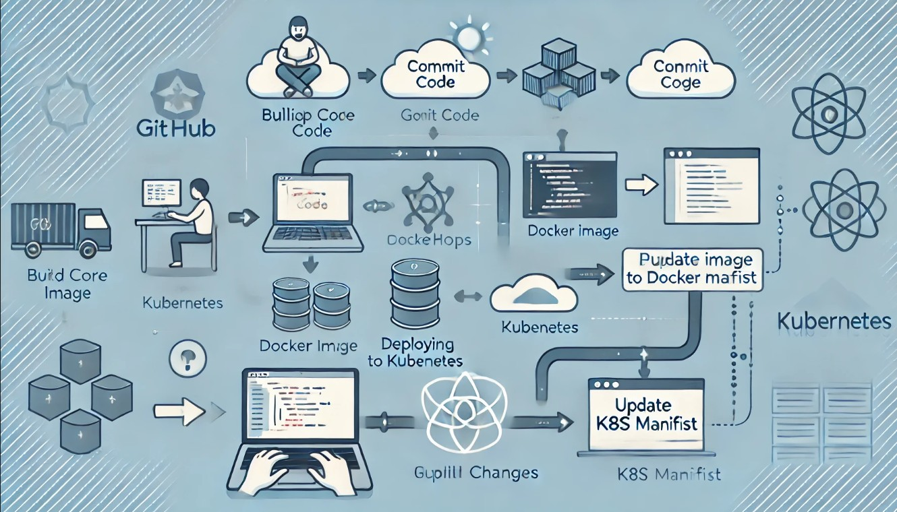
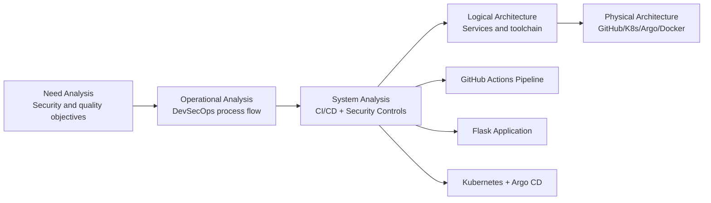
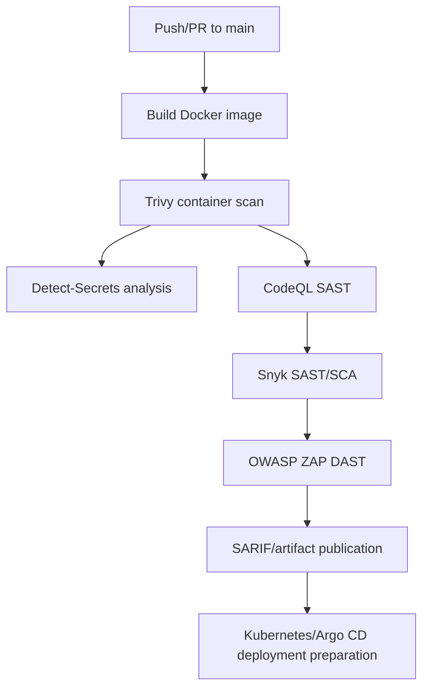
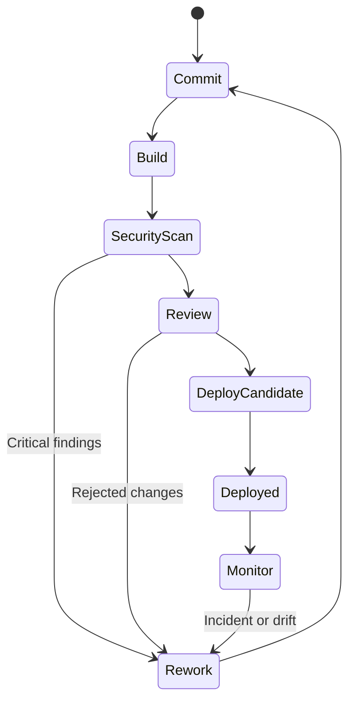
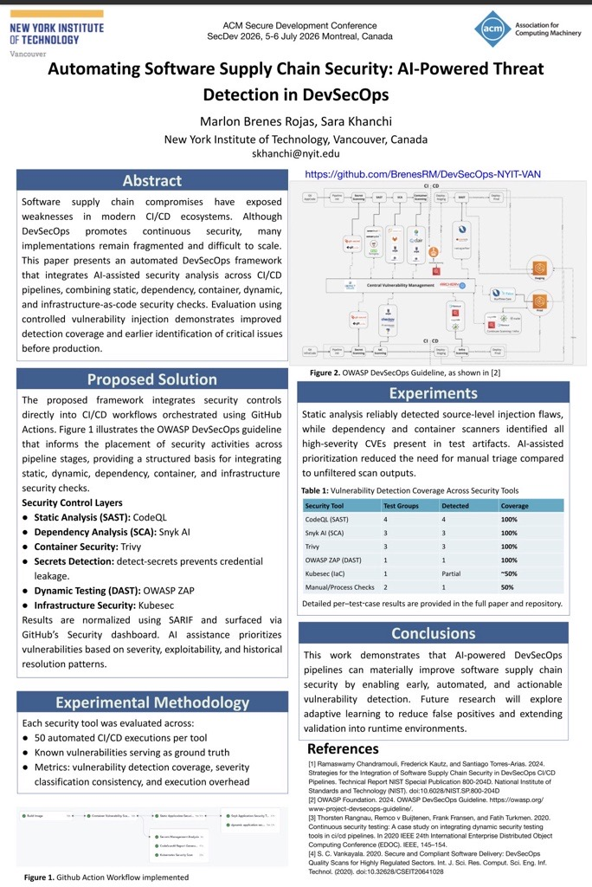

# DevSecOps-NYIT-VAN

Academic and practical repository designed to demonstrate a DevSecOps approach for software supply chain security, integrating automated security analysis in CI/CD, Kubernetes deployment, and GitOps operations with Argo CD.



## Table of Contents

- [Project Summary](#project-summary)
- [Technical Scope](#technical-scope)
- [Architecture (ISO/IEC 42010 + Arcadia)](#architecture-isoiec-42010--arcadia)
- [Flows and State Models (Mermaid)](#flows-and-state-models-mermaid)
- [Compliance and Reference Frameworks](#compliance-and-reference-frameworks)
- [Results and Evidence](#results-and-evidence)
- [Evidence Reproducibility (Console to CSV/XLSX)](#evidence-reproducibility-console-to-csvxlsx)
- [ACM Poster](#acm-poster)
- [Repository Structure](#repository-structure)
- [Limitations and Future Work](#limitations-and-future-work)
- [Contributing](#contributing)
- [License](#license)

## Project Summary

Developed in the context of INCS-870-VA-2025, this project implements a continuous security pipeline for software supply chain assurance, including SAST/DAST/SCA, container scanning, secret detection, and deployment-oriented controls.

## Technical Scope

- Flask web application with security controls for critical routes.
- GitHub Actions pipeline for build, security analysis, and reporting.
- Kubernetes deployment support and declarative GitOps operation with Argo CD.
- Academic evidence in PDF artifacts, LaTeX paper, and conference visual material.

## Architecture (ISO/IEC 42010 + Arcadia)

Architectural documentation follows ISO/IEC 42010 and an Arcadia-oriented layered view model (Need, Operational, System, Logical, Physical).



## Flows and State Models (Mermaid)

### Primary CI/CD security flow



### Operational state machine



## Compliance and Reference Frameworks

### ISO/IEC 42010 (Architecture Description)

- Stakeholders, concerns, viewpoints, and views are represented through security and deployment perspectives.
- Traceability is established between security objectives and architectural decisions.

### Arcadia (Model-Based Architecture Method)

- Layered decomposition is used to separate mission needs, operations, system capabilities, logical composition, and physical deployment.

### ISO/IEC 330xx (Process Assessment)

- Serves as a process capability reference for continuous improvement in secure SDLC execution.
- Applicable to CI/CD security orchestration, vulnerability management, and response processes.

### ISO/IEC 42001 (AI Management System)

- Provides governance guidance for AI-assisted threat detection, oversight, and risk control in automation contexts.

### OWASP AI and OWASP Cybersecurity

- OWASP guidance is applied to application and pipeline controls (SAST, DAST, SCA, secrets management).
- OWASP AI perspectives are considered for emerging risks such as model misuse, prompt abuse, and AI-related data exposure.

## Results and Evidence

This section synthesizes evidence using only artifacts located in the `Documentation/` directory, following a traceability-first academic reporting criterion.

### Source corpus used for evidence extraction

- `Documentation/Automating_Software_Supply_Chain_Security_AI_Powered_Threat_Detection_in_DevSecOps.pdf`
- `Documentation/Marlon_Brenes_Rojas_SecDev2026_Academic_Brief_7202.pdf`
- `Documentation/Test Cases/ZAP DAST/zap_scan/report_md.md`
- `Documentation/Test Cases/ZAP DAST/zap_scan/report_json.json`
- `Documentation/Test Cases/ZAP DAST/zap_scan/report_html.html`
- `Documentation/Test Cases/TestCases-Framework-OWASP.docx`
- `Documentation/Test Cases/testcase procedure.docx`
- `Documentation/Test Cases/test case formula.xlsx`
- `Documentation/SSH/Install SSH.md`
- `Documentation/export-code-scanning-report.ps1`
- `Documentation/notes.md`

### Security test evidence matrix

| Test ID | Security Control Domain | Tool / Method | Severity (Academic Classification) | Result (Documented) | Evidence Source |
|---|---|---|---|---|---|
| T-01 | Dynamic application security testing | OWASP ZAP report (markdown/json/html) | Medium/Low/Informational observed | ZAP summary reports `High: 0`, `Medium: 3`, `Low: 4`, `Informational: 6` and details per finding family | `Documentation/Test Cases/ZAP DAST/zap_scan/report_md.md`, `Documentation/Test Cases/ZAP DAST/zap_scan/report_json.json`, `Documentation/Test Cases/ZAP DAST/zap_scan/report_html.html` |
| T-02 | Security testing governance | OWASP-oriented test framework and procedures | Methodological control | Structured test framework and procedure artifacts are available for repeatable execution | `Documentation/Test Cases/TestCases-Framework-OWASP.docx`, `Documentation/Test Cases/testcase procedure.docx`, `Documentation/Test Cases/test case formula.xlsx` |
| T-03 | Evidence extraction reproducibility | GitHub Code Scanning export automation | Operational control | Scripted extraction path from REST API to CSV/XLSX is documented for periodic evidence collection | `Documentation/export-code-scanning-report.ps1` |
| T-04 | Academic synthesis and reporting | Research briefs and project report narrative | Cross-cutting evidence | Academic artifacts contextualize findings, controls, and architectural rationale for review committees | `Documentation/Automating_Software_Supply_Chain_Security_AI_Powered_Threat_Detection_in_DevSecOps.pdf`, `Documentation/Marlon_Brenes_Rojas_SecDev2026_Academic_Brief_7202.pdf` |
| T-05 | Operational security continuity | Argo CD and SSH recovery procedures | Medium | Operational notes include pod recovery, login, log inspection, and SSH service status checks | `Documentation/notes.md`, `Documentation/SSH/Install SSH.md` |

### Quantitative findings (documented)

From the ZAP report summary:

- High: 0 alerts
- Medium: 3 alerts
- Low: 4 alerts
- Informational: 6 alerts

Alert families explicitly listed include missing CSP header, missing anti-clickjacking header, HTTP-only exposure, and server version disclosure, among others.

### Academic interpretation

- The evidence set shows a multi-layer security strategy (SAST, DAST, container scanning, and secret scanning) with explicit CI/CD integration patterns.
- DAST findings are concentrated in Medium/Low/Informational severities in the documented execution snapshot, suggesting partial hardening with remaining header and transport-policy gaps.
- The vulnerable/secure application artifacts indicate intentional secure-by-design refactoring at route level, which supports a pedagogical before/after security narrative.

### Methodological limitations

- The current `Documentation/` corpus is strongest in DAST and operational procedures, while direct SAST/SCA/container-scan raw outputs are not centralized in the same folder.
- PDF artifacts support academic framing, but machine-readable longitudinal metrics are limited in the current documentary corpus.

### Metrics pending for future iterations

- Time series per pipeline run: findings by severity and tool.
- MTTR by vulnerability class and remediation owner.
- False-positive rate and triage acceptance ratio.
- Coverage metrics by route, dependency set, and container layer.

## Evidence Reproducibility (Console to CSV/XLSX)

To support repeatable academic reporting, this repository includes a PowerShell extractor for GitHub Code Scanning alerts:

- `Documentation/export-code-scanning-report.ps1`

### Execution from PowerShell

1. Define a token with permission to read Code Scanning alerts.
2. Run the extractor script from the repository root.

```powershell
$env:GITHUB_TOKEN = "<your_token>"
pwsh -NoProfile -ExecutionPolicy Bypass -File .\Documentation\export-code-scanning-report.ps1 -Owner "BrenesRM" -Repo "DevSecOps-NYIT-VAN" -State "open" -Format "both"
```

### Output artifacts

- CSV report for direct analysis in spreadsheets.
- XLSX report when `ImportExcel` module is available.
- Default destination folder: `reports/`.

This process reduces manual extraction bias from the web UI and improves traceability for periodic evidence collection.

## ACM Poster



## Repository Structure

```text
DevSecOps-NYIT-VAN/
├── .github/            # CI/CD workflows
├── Documentation/      # Academic evidence, images, and notes
├── argo/               # Argo CD configuration
├── k8s/                # Kubernetes manifests
├── static/             # Static assets
├── templates/          # HTML templates
├── Dockerfile          # Application container image
├── dockerfile-hardened # Hardened container variant
├── app.py              # Main Flask application
├── init_db.py          # Database initialization
├── requirements.txt    # Python dependencies
└── project.tex         # Academic paper source
```

## Limitations and Future Work

- Synchronize documentary workflows under `Documentation/old-workflows/` with the active `.github/workflows/` baseline to avoid configuration drift.
- Add a versioned evidence index per release (date, commit hash, tools, and scan scope).
- Integrate automatic publication of metrics dashboards (severity trends, MTTR, and remediation throughput).
- Expand empirical validation with repeated measurements to support stronger statistical conclusions.

## Contributing

1. Fork the repository.
2. Create a feature branch.
3. Execute tests and security validations.
4. Submit a Pull Request including evidence of changes.

## License

This project is licensed under the MIT License.
